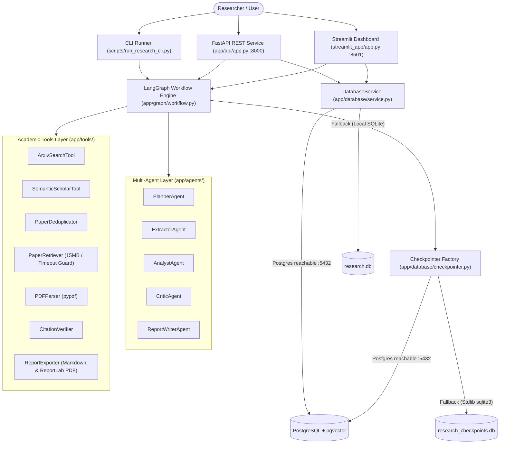
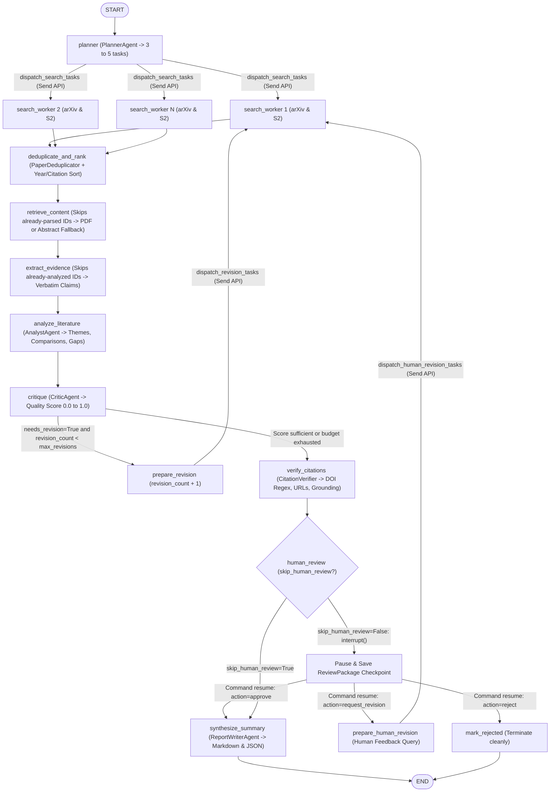
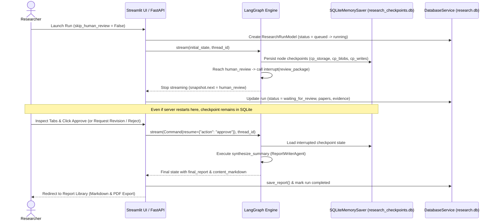
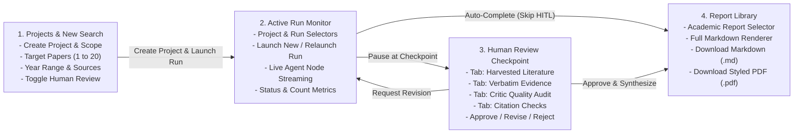
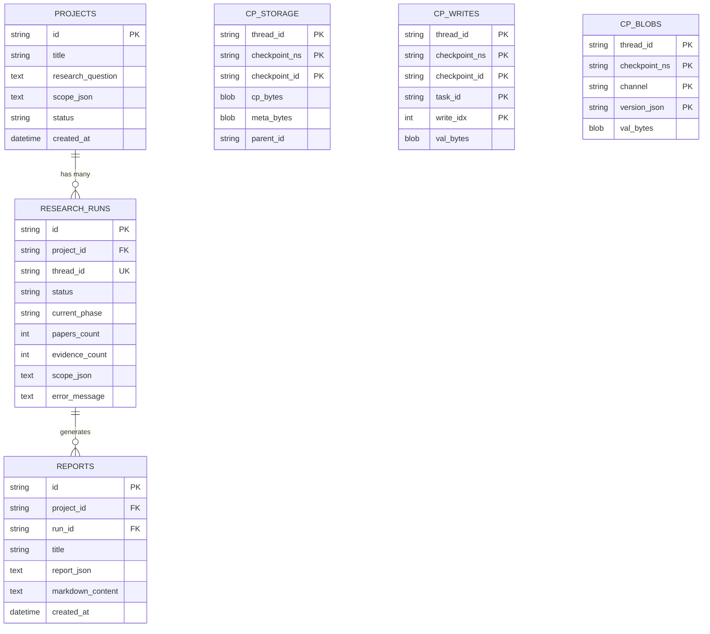

# MAS-RA: Complete Project Summary & Visual Flows

**Project:** Autonomous AI Research & Literature Review Assistant (MAS-RA)  
**Stack:** Python 3.12, LangGraph, LangChain / OpenAI (`gpt-4o-mini`), FastAPI, Streamlit, SQLAlchemy, SQLite / PostgreSQL (`pgvector`), ReportLab, `pypdf`  
**Verification Status:** 54/54 automated tests passing (`pytest -q`), Streamlit UI end-to-end flow verified, FastAPI REST service verified

---

## Table of Contents

1. [Project Overview](#1-project-overview)
2. [High-Level System Architecture Flow](#2-high-level-system-architecture-flow)
3. [End-to-End LangGraph Execution Flow](#3-end-to-end-langgraph-execution-flow)
4. [Human-in-the-Loop (HITL) & Persistent Checkpoint Sequence](#4-human-in-the-loop-hitl--persistent-checkpoint-sequence)
5. [Streamlit Dashboard User Journey](#5-streamlit-dashboard-user-journey)
6. [Database & Checkpoint Storage Schema](#6-database--checkpoint-storage-schema)
7. [Component & Module Reference](#7-component--module-reference)
   - [A. Multi-Agent Layer (`app/agents/`)](#a-multi-agent-layer-appagents)
   - [B. Academic Tools & Export Engine (`app/tools/`)](#b-academic-tools--export-engine-apptools)
   - [C. LangGraph State & Workflow (`app/graph/`)](#c-langgraph-state--workflow-appgraph)
   - [D. FastAPI Backend (`app/api/`)](#d-fastapi-backend-appapi)
   - [E. Persistence & Checkpointing (`app/database/`)](#e-persistence--checkpointing-appdatabase)
   - [F. Evaluation & Ablation Suite (`app/evaluation/`)](#f-evaluation--ablation-suite-appevaluation)
   - [G. Scripts, Deployment & Presentation Assets](#g-scripts-deployment--presentation-assets)
8. [How to Run the Application](#8-how-to-run-the-application)

---

## 1. Project Overview

MAS-RA automates systematic academic literature reviews through coordinated specialized AI agents rather than single-prompt LLM calls. Every empirical claim extracted from arXiv and Semantic Scholar literature is anchored to a verbatim source passage (`supporting_passage`), tagged with its provenance (`full_text` vs. `abstract_only`), audited by an adversarial critic with bounded self-refinement loops, verified against DOI/URL/grounding rules, optionally reviewed by a human at a persistent checkpoint interrupt, and compiled into Markdown and styled PDF reports.

---

## 2. High-Level System Architecture Flow



---

## 3. End-to-End LangGraph Execution Flow

Implemented in [`app/graph/workflow.py`](app/graph/workflow.py) and [`app/graph/nodes.py`](app/graph/nodes.py) over shared [`ResearchState`](app/graph/state.py):



---

## 4. Human-in-the-Loop (HITL) & Persistent Checkpoint Sequence

Backed by [`SQLiteMemorySaver`](app/database/checkpointer.py) (`research_checkpoints.db`), allowing paused `human_review` runs to survive server restarts without binary PostgreSQL driver dependencies:



---

## 5. Streamlit Dashboard User Journey

Implemented in [`streamlit_app/app.py`](streamlit_app/app.py) with `@st.cache_resource` shared graph compilation, synchronized `_pending_nav` tab redirection, real-time node streaming, and native Streamlit containers:



---

## 6. Database & Checkpoint Storage Schema

Domain records persist via SQLAlchemy ORM in [`app/database/models.py`](app/database/models.py) (`research.db` or PostgreSQL), while LangGraph execution checkpoints persist in `research_checkpoints.db` (or `PostgresSaver`):



---

## 7. Component & Module Reference

### A. Multi-Agent Layer (`app/agents/`)

| Agent | File | Responsibility | Output Schema / Fallback |
| :--- | :--- | :--- | :--- |
| **PlannerAgent** | [`app/agents/planner.py`](app/agents/planner.py) | Decomposes inquiry into 3 to 5 orthogonal search tasks (`function_calling`) | `ResearchPlan` (`_heuristic_fallback_plan`) |
| **ExtractorAgent** | [`app/agents/extractor.py`](app/agents/extractor.py) | Extracts methods, benchmarks, and verbatim grounded evidence items | `PaperAnalysis` + `List[Evidence]` (`_heuristic_fallback_extraction`) |
| **AnalystAgent** | [`app/agents/analyst.py`](app/agents/analyst.py) | Synthesizes themes, cross-paper comparisons, disagreements, and gaps | `ResearchSynthesis` (`_heuristic_fallback_synthesis`) |
| **CriticAgent** | [`app/agents/critic.py`](app/agents/critic.py) | Audits thematic coverage (score `0.0-1.0`) and triggers bounded revision tasks | `Critique` (`_heuristic_fallback_critique`) |
| **ReportWriterAgent** | [`app/agents/writer.py`](app/agents/writer.py) | Authors publication-grade literature review with references and audit checks | `ResearchReport` (`_write_deterministic`) |

### B. Academic Tools & Export Engine (`app/tools/`)

| Tool | File | Function |
| :--- | :--- | :--- |
| **ArxivSearchTool** | [`app/tools/arxiv_search.py`](app/tools/arxiv_search.py) | Queries arXiv Atom API with polite rate-limit delay and year filtering |
| **SemanticScholarTool** | [`app/tools/semantic_scholar.py`](app/tools/semantic_scholar.py) | Queries Semantic Scholar Graph API with exponential backoff on HTTP `429` |
| **PaperDeduplicator** | [`app/tools/paper_dedup.py`](app/tools/paper_dedup.py) | Deduplicates by normalized DOI, provider ID, title, and Jaccard similarity (`> 0.85`), merging provider sources |
| **PaperRetriever** | [`app/tools/paper_retriever.py`](app/tools/paper_retriever.py) | Streams PDFs with 15 MB ceiling, wall-clock timeout deadline, and `%PDF` header check |
| **PDFParser** | [`app/tools/pdf_parser.py`](app/tools/pdf_parser.py) | Parses full text via `pypdf`, cleans ligatures/hyphens, segments sections, falls back to `abstract_only` / `metadata_only` |
| **CitationVerifier** | [`app/tools/citation_verifier.py`](app/tools/citation_verifier.py) | Validates DOI regex syntax, verifies source URLs, and confirms evidence grounding per paper |
| **ReportExporter** | [`app/tools/report_exporter.py`](app/tools/report_exporter.py) | Formats Markdown and XML-escaped styled PDF documents via ReportLab |

### C. LangGraph State & Workflow (`app/graph/`)

- **State ([`app/graph/state.py`](app/graph/state.py)):** Tracks `research_plan`, `research_tasks`, `search_results` (`merge_papers_reducer`), `selected_papers`, `paper_contents` (`operator.add`), `extracted_evidence` (`operator.add`), `paper_analyses` (`operator.add`), `synthesis`, `critique`, `verified_citations`, `review_package`, `revision_count`, `final_report`, and `status`.
- **Prompts ([`app/graph/prompts.py`](app/graph/prompts.py)):** Version-controlled system and user templates for Planner, Extractor, Analyst, Critic, and Report Writer.
- **Nodes & Workflow ([`app/graph/nodes.py`](app/graph/nodes.py), [`app/graph/workflow.py`](app/graph/workflow.py)):** Handles dynamic `Send()` fan-out, skips duplicate downloads/extractions on revision loops, executes HITL `interrupt()`, and compiles the StateGraph.

### D. FastAPI Backend (`app/api/`)

Exposed in [`app/api/app.py`](app/api/app.py) and [`app/api/routes.py`](app/api/routes.py):

- **Health:** `GET /health`
- **Projects:** `POST /api/projects`, `GET /api/projects`, `GET /api/projects/{project_id}`
- **Runs:** `POST /api/projects/{project_id}/runs`, `GET /api/runs/{run_id}`
- **Artifacts & Inspection:** `GET /api/runs/{run_id}/papers`, `GET /api/runs/{run_id}/evidence`
- **Human Review:** `GET /api/runs/{run_id}/review`, `POST /api/runs/{run_id}/review`
- **Reports & Export:** `GET /api/runs/{run_id}/report`, `GET /api/runs/{run_id}/export/markdown`, `GET /api/runs/{run_id}/export/pdf`

### E. Persistence & Checkpointing (`app/database/`)

- [`app/database/models.py`](app/database/models.py): SQLAlchemy 2.0 models `ProjectModel`, `ResearchRunModel`, `ReportModel`.
- [`app/database/service.py`](app/database/service.py): `DatabaseService` repository with socket pre-check (`_is_postgres_available`), automatic fallback to SQLite (`research.db` or `MAS_LOCAL_SQLITE_URL` during tests), and `selectinload` eager loading.
- [`app/database/checkpointer.py`](app/database/checkpointer.py): `get_checkpointer()` returning `MemorySaver` in testing, `PostgresSaver` when Postgres is reachable, or persistent [`SQLiteMemorySaver`](app/database/checkpointer.py) (`research_checkpoints.db`).

### F. Evaluation & Ablation Suite (`app/evaluation/`)

- [`app/evaluation/metrics.py`](app/evaluation/metrics.py): `MetricsCalculator` computing `CitationEvaluationResult` (DOI validity, URL accessibility, claim support), `EvidenceEvaluationResult` (`full_text` vs `abstract_only` ratio, confidence), `CoverageEvaluationResult`, and `SystemBenchmarkScore`.
- [`app/evaluation/ablation_runner.py`](app/evaluation/ablation_runner.py): `AblationExperimentRunner` comparing `full_multi_agent` vs `ablation_no_critic_revisions` against [`data/evaluation/benchmark_queries.json`](data/evaluation/benchmark_queries.json).

### G. Scripts, Deployment & Presentation Assets

- **CLI Scripts (`scripts/`):**
  - [`scripts/run_research_cli.py`](scripts/run_research_cli.py): End-to-end terminal pipeline runner.
  - [`scripts/run_benchmark_evaluation.py`](scripts/run_benchmark_evaluation.py): Benchmark and ablation runner.
  - [`scripts/backup_database.py`](scripts/backup_database.py) & [`scripts/restore_database.py`](scripts/restore_database.py): JSON database backup/restore utilities.
- **Deployment & Migrations:** [`Dockerfile`](Dockerfile), [`docker-compose.yml`](docker-compose.yml), [`alembic/`](alembic/), and [`.github/workflows/ci.yml`](.github/workflows/ci.yml).
- **Presentation Deck:** [`generate_deck.py`](generate_deck.py) and [`MAS_RA_Academic_Presentation.pptx`](MAS_RA_Academic_Presentation.pptx) (12-slide 16:9 academic presentation with embedded speaker notes).

---

## 8. How to Run the Application

```powershell
# 1. Start Streamlit Web Dashboard (http://localhost:8501)
.\.venv\Scripts\python.exe -m streamlit run streamlit_app/app.py --server.port 8501

# 2. Start FastAPI Backend (http://localhost:8000/docs)
.\.venv\Scripts\python.exe -m uvicorn app.api.app:app --host 0.0.0.0 --port 8000 --reload

# 3. Run Single Research Query via CLI
.\.venv\Scripts\python.exe scripts/run_research_cli.py --question "How are multi-agent AI systems improving autonomous software engineering?" --max-papers 3

# 4. Run Automated Test Suite (Isolated from research.db)
.\.venv\Scripts\python.exe -m pytest -q
```

