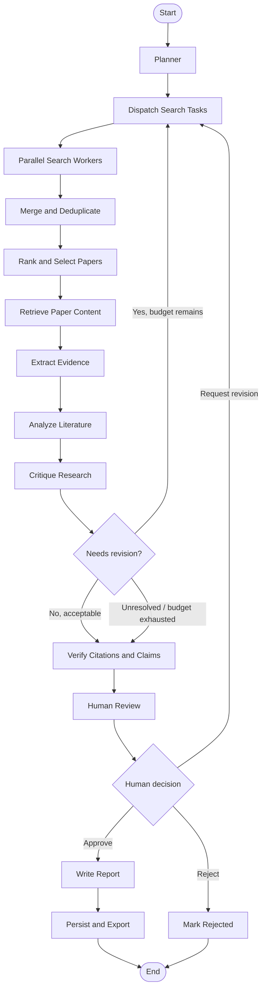
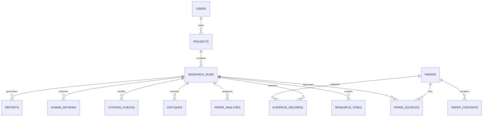

# Complete end-to-end build plan: Autonomous AI Research & Literature Review System

We’ll treat this as a research-grade software engineering project, not just a LangGraph demo. The goal is to build a working application that accepts a research question, finds academic literature, extracts evidence, analyzes and critiques findings, verifies citations, and produces a structured literature review—with traceability, human oversight, evaluation, and deployment.

The central design decision is to separate the system into three layers:

1. Research intelligence: agents, tools, retrieval, evidence extraction, synthesis and verification.
2. Application infrastructure: API, database, checkpointing, job execution, logging and evaluation.
3. User experience: Streamlit interface for starting, monitoring, reviewing and exporting research.

We’ll build the project incrementally, testing each layer before moving on.

## 1. Define the finished product

## What the finished system will do

1. Accept a research question, scope, date range and preferred academic sources.
2. Generate a structured research plan with subquestions, keywords and search strategies.
3. Search arXiv and Semantic Scholar in parallel.
4. Deduplicate, rank and select relevant papers.
5. Retrieve accessible full text where permitted; otherwise use abstracts and metadata.
6. Extract methodology, datasets, findings, limitations and evidence passages.
7. Compare papers, identify themes, disagreements, trends and research gaps.
8. Critique coverage and evidence, then perform targeted research revisions.
9. Verify bibliographic metadata and link claims to supporting evidence.
10. Request human approval when needed.
11. Generate a structured literature review with references and limitations.
12. Save the project, resume interrupted runs and export the report.

Example user request

> How are multi-agent AI systems improving autonomous software engineering? Compare architectures, evaluation methods, benchmarks, limitations, and open research challenges from 2020 to 2026.

Expected output

- Research plan and search history
- List of selected papers
- Paper-by-paper evidence summaries
- Comparative analysis
- Research gaps and open questions
- Literature review with citations
- Evidence-to-source traceability
- Evaluation and quality report
- Exportable Markdown and PDF

The system must never pretend to have read full papers when it only accessed abstracts.

## 2. Final technology stack

| Layer               | Technology                        | Responsibility                                    |
| ------------------- | --------------------------------- | ------------------------------------------------- |
| Language            | Python                            | Core implementation                               |
| LLM                 | OpenAI API                        | Planning, extraction, analysis, critique, writing |
| Agent orchestration | LangGraph                         | State, routing, parallel execution, revisions     |
| LLM integration     | LangChain OpenAI                  | Model interface and structured output             |
| Academic search     | arXiv API                         | Preprints and metadata                            |
| Academic search     | Semantic Scholar API              | Papers and citation metadata                      |
| Validation          | Pydantic v2                       | Input/output contracts                            |
| Backend             | FastAPI                           | Application API                                   |
| Frontend            | Streamlit                         | Research dashboard                                |
| Database            | PostgreSQL                        | Projects, papers, reports and evidence            |
| ORM                 | SQLAlchemy                        | Database access                                   |
| Graph checkpointing | LangGraph PostgreSQL checkpointer | Pause and resume workflows                        |
| Vector retrieval    | pgvector                          | Evidence and document retrieval                   |
| Embeddings          | OpenAI embeddings                 | Semantic search                                   |
| Observability       | LangSmith                         | Tracing and experiments                           |
| Testing             | pytest                            | Unit, integration and workflow tests              |
| Evaluation          | Custom metrics + LangSmith        | Research quality assessment                       |
| Containers          | Docker Compose                    | Reproducible deployment                           |
| CI/CD               | GitHub Actions                    | Automated testing and deployment                  |

We’ll keep the initial architecture manageable: one FastAPI service, one Streamlit frontend, PostgreSQL, and a LangGraph workflow. We can add Redis and a separate worker service when concurrency or workload requires them.

## 3. System architecture

The application will follow this architecture:

```
                   USER
                    |
                    v
             STREAMLIT FRONTEND
                    |
                    v
              FASTAPI BACKEND
                    |
          +---------+---------+
          |                   |
          v                   v
     PostgreSQL          Job / Run API
          |                   |
          |                   v
          |              LANGGRAPH
          |                   |
          |       +-----------+-----------+
          |       |           |           |
          |       v           v           v
          |    PLANNER     SEARCH      RETRIEVAL
          |                 WORKERS     / PARSER
          |                   |
          |          +--------+--------+
          |          |                 |
          |          v                 v
          |        arXiv         Semantic Scholar
          |          |                 |
          |          +--------+--------+
          |                   |
          |                   v
          |             DEDUPLICATION
          |                   |
          |                   v
          |             PAPER SELECTION
          |                   |
          |                   v
          |             EVIDENCE EXTRACTION
          |                   |
          |                   v
          |             ANALYSIS AGENT
          |                   |
          |                   v
          |             CRITIC AGENT
          |                   |
          |              revise?
          |               /    \
          |             yes     no
          |              |       |
          |              +--->   v
          |                  CITATION
          |                 VERIFICATION
          |                       |
          |                       v
          |                  HUMAN REVIEW
          |                       |
          |                       v
          |                  REPORT WRITER
          |                       |
          +-----------------------+
                                  |
                                  v
                          FINAL RESEARCH REPORT

       LANGSMITH: traces, errors, latency and evaluation
```

### Responsibilities of each agent

| Agent / component | Responsibility                               | Output                      |
| ----------------- | -------------------------------------------- | --------------------------- |
| Planner           | Break down the research question             | Research plan               |
| Search worker     | Search one task against academic sources     | Candidate papers            |
| Deduplicator      | Merge duplicate records                      | Unique papers               |
| Ranker            | Prioritize relevant papers                   | Selected papers             |
| Retriever         | Retrieve available paper content             | Text and metadata           |
| Extractor         | Extract structured information               | Evidence records            |
| Analyst           | Compare findings across papers               | Synthesis                   |
| Critic            | Identify missing coverage and weak reasoning | Critique and revision tasks |
| Citation verifier | Check bibliographic metadata and claim links | Verification records        |
| Human reviewer    | Approve, reject or request changes           | Review decision             |
| Writer            | Generate the final report                    | Literature review           |

Not every component needs to be an LLM agent. Deduplication, parsing, metadata checks, ranking baselines and citation checks should use deterministic code wherever possible. This reduces cost and makes results easier to test.

## 4. Repository structure

This is the target repository. We will build it in stages rather than creating every file at once.

```
ai-research-assistant/
│
├── app/
│   ├── __init__.py
│   │
│   ├── agents/
│   │   ├── planner.py
│   │   ├── extractor.py
│   │   ├── analyst.py
│   │   ├── critic.py
│   │   └── writer.py
│   │
│   ├── graph/
│   │   ├── state.py
│   │   ├── nodes.py
│   │   ├── routing.py
│   │   ├── workflow.py
│   │   └── prompts.py
│   │
│   ├── tools/
│   │   ├── arxiv_search.py
│   │   ├── semantic_scholar.py
│   │   ├── paper_dedup.py
│   │   ├── paper_ranker.py
│   │   ├── paper_retriever.py
│   │   ├── pdf_parser.py
│   │   └── citation_verifier.py
│   │
│   ├── schemas/
│   │   ├── research.py
│   │   ├── papers.py
│   │   ├── evidence.py
│   │   ├── report.py
│   │   └── api.py
│   │
│   ├── services/
│   │   ├── research_service.py
│   │   ├── project_service.py
│   │   ├── export_service.py
│   │   └── evaluation_service.py
│   │
│   ├── database/
│   │   ├── connection.py
│   │   ├── models.py
│   │   ├── repositories.py
│   │   └── migrations/
│   │
│   ├── api/
│   │   ├── routes/
│   │   │   ├── projects.py
│   │   │   ├── research.py
│   │   │   ├── papers.py
│   │   │   └── reports.py
│   │   └── dependencies.py
│   │
│   ├── evaluation/
│   │   ├── dataset.py
│   │   ├── metrics.py
│   │   ├── evaluators.py
│   │   └── experiments.py
│   │
│   ├── config.py
│   └── main.py
│
├── frontend/
│   ├── streamlit_app.py
│   ├── pages/
│   │   ├── 1_Research_Projects.py
│   │   ├── 2_Run_Research.py
│   │   ├── 3_Paper_Library.py
│   │   ├── 4_Evidence_Review.py
│   │   ├── 5_Final_Reports.py
│   │   └── 6_Evaluation.py
│   └── components/
│       ├── paper_card.py
│       └── report_viewer.py
│
├── tests/
│   ├── unit/
│   ├── integration/
│   ├── graph/
│   ├── api/
│   └── evaluation/
│
├── data/
│   ├── benchmark/
│   ├── fixtures/
│   └── sample_papers/
│
├── reports/
├── scripts/
├── docs/
│   ├── architecture.md
│   ├── prompts.md
│   ├── evaluation.md
│   └── deployment.md
│
├── .env.example
├── .gitignore
├── requirements.txt
├── Dockerfile
├── docker-compose.yml
├── alembic.ini
└── README.md
```

## 5. Define the data contracts before building agents

A multi-agent system becomes difficult to maintain when agents exchange inconsistent data. Therefore, all major inputs and outputs should have explicit Pydantic schemas.

These are the main data entities we need.

| Entity            | Important fields                                      |
| ----------------- | ----------------------------------------------------- |
| ResearchProject   | project ID, title, question, scope, status            |
| ResearchPlan      | objective, tasks, keywords, inclusion criteria        |
| ResearchTask      | task ID, subquestion, query, priority                 |
| Paper             | canonical ID, title, authors, year, DOI, provider IDs |
| PaperContent      | paper ID, content, content type, retrieval status     |
| Evidence          | evidence ID, paper ID, passage, page, section, claim  |
| PaperAnalysis     | methodology, datasets, findings, limitations          |
| ResearchSynthesis | themes, comparisons, disagreements, gaps              |
| Critique          | quality score, missing topics, unsupported claims     |
| CitationCheck     | metadata status, DOI status, URL status               |
| ResearchReport    | sections, claims, citations, limitations              |
| HumanReview       | decision, reviewer feedback, timestamp                |

Important data-model decision: keep bibliographic records separate from evidence records.

A paper is a source. An evidence record is a specific passage or finding from that source. A citation is a reference to a source. A claim is an assertion in the report. These are related but not interchangeable.

For example:

```
Paper: Paper A
    |
    +---- Evidence E1: "The system reduced task completion time..."
    |
    +---- Evidence E2: "The authors used benchmark X..."
    |
    +---- Evidence E3: "The study was limited to..."
                 |
                 v
          Report Claim C1
                 |
                 v
          Citation to Paper A
```

This relationship is essential for checking whether a report's claims are genuinely supported.

## 6. Design the LangGraph workflow

The graph should have explicit nodes, conditional routes, parallel execution and a human approval checkpoint.

### Main graph



### Workflow execution rules

- The planner creates bounded research tasks, not an unlimited list.
- Each task can search multiple providers concurrently.
- The search workers return normalized records.
- The graph merges results before downstream extraction.
- The ranker selects papers based on relevance, coverage, date and source diversity.
- The extractor stores evidence with source references.
- The critic can request targeted additional research.
- Revision count and token/search budgets prevent endless loops.
- A weak critique result must not be silently treated as an approval.
- Human approval is implemented as a real checkpointed interrupt, not merely a node that automatically continues.
- The final report is generated only from persisted evidence and verified source records.

### Shared graph state

The state should eventually contain:

```python
from typing import TypedDict, Annotated
import operator

def merge_papers(existing: list[dict], new_items: list[dict]) -> list[dict]:
    """Deduplicates and merges paper collections across parallel searches."""
    ...

class ResearchState(TypedDict, total=False):
    project_id: str
    research_question: str
    scope: dict
    research_plan: dict
    research_tasks: list[dict]
    search_results: Annotated[list[dict], merge_papers]
    selected_papers: list[dict]
    paper_contents: list[dict]
    extracted_papers: list[dict]
    evidence_records: list[dict]
    analysis: dict
    critique: dict
    verified_citations: list[dict]
    revision_count: int
    max_revisions: int
    max_results_per_task: int
    selected_sources: list[str]
    human_approved: bool
    human_feedback: str
    final_report: dict
    errors: Annotated[list[str], operator.add]
    status: str
```

This is a target design, not yet the final implementation. We’ll define reducers for all collections that can receive updates from parallel workers or multiple revision cycles. We’ll also keep worker input schemas separate from the global state, since LangGraph `Send` tasks carry their own payload.

## 7. Complete development roadmap

The project will be built in 15 phases. Each phase has a deliverable and a testable completion condition.

## Phase 1 — Project foundation

Foundation

Tasks

- Create the repository and virtual environment.
- Install and pin dependencies.
- Create configuration management.
- Set up `.env`, `.gitignore` and logging.
- Define Pydantic schemas.
- Set up pytest and initial tests.

Deliverable: A clean Python project with configuration, schemas and tests.

Completion condition: Application imports successfully, configuration validates, and unit tests pass.

## Phase 2 — Academic search tools

In progress

Tasks

- Implement arXiv search.
- Implement Semantic Scholar search.
- Normalize provider responses.
- Implement DOI and title deduplication.
- Add timeout, retry and rate-limit handling.
- Record provider-specific IDs and URLs.
- Add mocked API tests and live smoke tests.

Deliverable: A working academic retrieval layer.

Completion condition: Both providers return normalized paper records and duplicate records merge correctly.

## Phase 3 — Planner Agent

Tasks

- Design planner system prompt.
- Define structured `ResearchPlan` output.
- Convert the research question into subquestions.
- Generate keywords and alternative search queries.
- Add inclusion and exclusion criteria.
- Validate that the plan covers all requested dimensions.
- Add planner tests with representative research questions.

Deliverable: A reliable research planning agent.

Completion condition: The agent returns valid, bounded and relevant research tasks.

## Phase 4 — LangGraph parallel search

Tasks

- Define shared state and reducers.
- Implement `Send`-based dynamic task dispatch.
- Implement the search worker node.
- Search multiple providers per task.
- Merge parallel results.
- Add error handling and task-level status.
- Test concurrent execution and fan-in behavior.

Deliverable: Planner-to-search graph.

Completion condition: One question produces multiple search tasks, runs workers in parallel and returns deduplicated results.

## Phase 5 — Paper selection and retrieval

Tasks

- Implement relevance ranking.
- Add date and topic filters.
- Add diversity-aware paper selection.
- Retrieve accessible PDFs or full text where permitted.
- Parse PDFs into text.
- Store extraction status and content provenance.
- Handle inaccessible, scanned and malformed PDFs.
- Apply per-paper and total document-size limits.

Deliverable: A selected and retrievable research corpus.

Completion condition: The system can select relevant papers and accurately report whether it has full text, abstract-only content or no accessible content.

## Phase 6 — Evidence extraction agent

Tasks

- Design structured extraction prompts.
- Extract objectives and research questions.
- Extract methodologies and architectures.
- Extract datasets and evaluation metrics.
- Extract findings and limitations.
- Save exact supporting passages and page/section locations where available.
- Store extraction confidence and evidence scope.
- Reject unsupported or untraceable extracted statements.

Deliverable: Structured paper analyses and evidence records.

Completion condition: Every extracted finding is linked to its source and, where available, a passage in that source.

## Phase 7 — Literature analysis agent

Tasks

- Group papers into themes.
- Compare methodologies.
- Compare datasets and benchmarks.
- Identify agreement and disagreement.
- Analyze temporal developments.
- Identify research gaps.
- Distinguish author-reported findings from cross-paper conclusions.
- Generate a structured synthesis.

Deliverable: A multi-paper literature analysis.

Completion condition: The output compares sources instead of merely summarizing papers one by one.

## Phase 8 — Critic and research revision loop

Tasks

- Evaluate topic coverage.
- Identify missing subquestions.
- Detect unsupported claims.
- Detect contradictory findings.
- Identify source imbalance.
- Generate targeted additional tasks.
- Implement bounded revision loops.
- Track revision reasons and quality changes.

Deliverable: A self-critiquing research workflow.

Completion condition: The graph can request focused additional research, stop at a defined budget and flag unresolved weaknesses.

## Phase 9 — Citation and claim verification

Tasks

- Validate DOI format and DOI resolution.
- Validate source URLs.
- Compare paper title, author and year metadata.
- Check that cited papers exist in the stored corpus.
- Link report claims to evidence records.
- Distinguish bibliographic validity from claim support.
- Flag citations that are valid but do not support the associated claim.
- Prevent unsupported citations from being presented as verified.

Deliverable: Citation verification subsystem.

Completion condition: Each report citation resolves to a stored source, and each substantive claim has a traceable evidence link or an explicit unsupported status.

## Phase 10 — Human-in-the-loop review

Tasks

- Add a LangGraph interrupt before report finalization.
- Persist checkpoints in PostgreSQL.
- Show sources and evidence to the reviewer.
- Allow approval, rejection or revision requests.
- Resume execution with `Command(resume=...)`.
- Preserve reviewer decisions and feedback.
- Test process interruption and resumption.

Deliverable: A reviewable research workflow.

Completion condition: A research run can pause, survive a service restart and resume from its saved checkpoint.

## Phase 11 — Report writer

Tasks

- Define report structure and output schema.
- Generate abstract and introduction.
- Write themed literature review.
- Generate comparative analysis.
- Write research gaps and limitations.
- Generate future research directions.
- Insert references using a consistent citation style.
- Attach evidence and citation identifiers.
- Run final consistency and citation checks.

Deliverable: A complete structured literature review.

Completion condition: The report is generated from verified records, has a complete bibliography and makes its evidence limitations clear.

## Phase 12 — Database and persistence

Tasks

- Design PostgreSQL tables and relationships.
- Add SQLAlchemy models.
- Add Alembic migrations.
- Store projects, runs, tasks, papers and evidence.
- Store report versions and review decisions.
- Configure LangGraph PostgreSQL checkpointing.
- Add indexes and database constraints.
- Add backup and restore procedures.

Deliverable: Persistent research workspace.

Completion condition: Projects and research runs remain available across application restarts, with no dependence on in-memory state.

## Phase 13 — FastAPI and Streamlit application

Tasks

- Build project creation and listing endpoints.
- Build research execution endpoints.
- Build run-status and progress endpoints.
- Build paper and evidence endpoints.
- Build human-review endpoints.
- Build report retrieval and export endpoints.
- Create Streamlit project dashboard.
- Create research configuration interface.
- Display live or periodically refreshed progress.
- Build paper library, evidence review and report pages.

Deliverable: An end-to-end research application.

Completion condition: A user can create a project, launch a run, inspect evidence, approve the review and export a report without using a terminal.

## Phase 14 — Evaluation and research experiments

Tasks

- Build a benchmark dataset.
- Collect human-reviewed reference answers.
- Define retrieval and evidence metrics.
- Compare single-agent and multi-agent configurations.
- Evaluate citation validity and claim support.
- Measure coverage and contradiction handling.
- Measure latency, token usage and cost.
- Perform ablation experiments.
- Save experiment configurations and results.
- Document limitations and reproducibility.

Deliverable: Quantitative evaluation of system quality.

Completion condition: The system's performance can be measured and compared, with no fabricated or unsubstantiated performance claims.

## Phase 15 — Production hardening and deployment

Tasks

- Add authentication and project-level authorization.
- Secure API keys and secrets.
- Add input validation and request limits.
- Add retries, timeouts and graceful failure handling.
- Add structured logs and tracing.
- Add Dockerfiles and Docker Compose.
- Add CI tests and migration checks.
- Configure deployment, HTTPS and backups.
- Add health checks and operational monitoring.
- Document installation, usage and troubleshooting.

Deliverable: A deployable, maintainable research assistant.

Completion condition: The application starts from a documented deployment process, passes automated checks and can recover from common failures.

## 8. Database design

Use PostgreSQL as the system of record. LangGraph checkpoints are important, but they should not replace the application's own domain database.

The initial relational model should include:

| Table                | Purpose                                            | Important relationships  |
| -------------------- | -------------------------------------------------- | ------------------------ |
| `users`              | Application users                                  | Own projects             |
| `projects`           | Research projects                                  | Belongs to user          |
| `research_runs`      | Each execution of a project                        | Belongs to project       |
| `research_tasks`     | Planner-generated tasks                            | Belongs to run           |
| `papers`             | Canonical paper metadata                           | Reused across runs       |
| `paper_sources`      | Provider-specific records                          | Belongs to paper         |
| `paper_contents`     | Abstracts, parsed full text and retrieval metadata | Belongs to paper         |
| `evidence_records`   | Supporting passages and extracted findings         | Belongs to paper and run |
| `paper_analyses`     | Structured analysis of each paper                  | Belongs to paper and run |
| `syntheses`          | Cross-paper analysis                               | Belongs to run           |
| `critiques`          | Quality reviews and revision requests              | Belongs to run           |
| `citation_checks`    | Bibliographic and claim checks                     | Belongs to run           |
| `human_reviews`      | Reviewer decisions and feedback                    | Belongs to run           |
| `reports`            | Final reports and versions                         | Belongs to run           |
| `evaluation_results` | Benchmark metrics and experiment outcomes          | Belongs to experiment    |

### Important relationships



### Database design rules

- Use UUIDs for application-level entities.
- Keep provider-specific IDs in `paper_sources`, not only in the canonical paper record.
- Add unique constraints for normalized DOI values when present.
- Preserve raw provider responses where appropriate for auditability, subject to storage and licensing requirements.
- Store timestamps in UTC.
- Version reports and prompts.
- Store the model name, configuration and prompt version for each run.
- Keep graph checkpoints in the dedicated LangGraph checkpoint tables.
- Use Alembic migrations rather than manually modifying production tables.

For semantic retrieval, pgvector can store embeddings for chunks or evidence passages. It should supplement—not replace—relational links to papers, evidence and citations.

## 9. Retrieval and evidence strategy

This is one of the most important design decisions in the entire project.

A literature review should not simply ask an LLM to read a large collection of abstracts and write an essay. We need a defensible evidence pipeline.

### Retrieval stages

Stage A — Search

Search providers with multiple queries generated from the research plan.

Stage B — Normalize

Convert provider records to a shared paper schema.

Stage C — Deduplicate

Use DOI first, provider identifiers second, and title/author/year matching as a fallback. Keep uncertain matches reviewable.

Stage D — Rank

Use a combination of:

- Semantic relevance to the research question
- Keyword overlap
- Publication year and requested time range
- Coverage of different subtopics
- Availability of an abstract or full text
- Source metadata quality

Do not rank papers purely by citation count. Older papers often have more citations, and citation count is not a direct measure of relevance or quality.

Stage E — Retrieve content

Attempt to retrieve legally accessible full text. If unavailable, retain the abstract and label the evidence scope accordingly.

Stage F — Chunk and index

Split long papers into meaningful sections, preserve page/section information, and create embeddings for semantic retrieval.

Stage G — Extract evidence

Ask the extraction agent to produce structured evidence records from relevant sections, with exact supporting text and locations where possible.

### Example evidence record

```
{
  "evidence_id": "evidence-001",
  "paper_id": "doi:10.1234/example",
  "evidence_type": "finding",
  "claim": "The proposed agent architecture improves task completion.",
  "supporting_passage": "The authors report improved task completion...",
  "section": "Results",
  "page": 8,
  "content_scope": "full_text",
  "extraction_confidence": 0.88
}
```

The confidence shown here is illustrative. In a real run, it should be produced by a defined scoring or evaluation process—not treated as a calibrated probability simply because an LLM outputs a number.

### Evidence quality rules

1. A report claim must link to one or more evidence records.
2. An evidence record must link to a specific paper.
3. The system must distinguish direct author findings from the system's own cross-paper interpretation.
4. If a source only has an abstract, the report must not describe methods or limitations that were not present in the abstract.
5. Contradictory results should be presented, not silently averaged.
6. Missing evidence must be represented as missing—not filled in by model inference.

## 10. Prompt engineering plan

Store prompts in version-controlled files or Python modules, not scattered throughout graph nodes.

| Prompt             | Input                                      | Expected output             |
| ------------------ | ------------------------------------------ | --------------------------- |
| Planner            | Research question and scope                | Research plan               |
| Query generator    | Research task                              | Search queries              |
| Paper extractor    | Paper content                              | Structured paper analysis   |
| Evidence extractor | Relevant passages                          | Evidence records            |
| Analyst            | Multiple paper analyses                    | Comparative synthesis       |
| Critic             | Plan, synthesis and evidence               | Critique and revision tasks |
| Citation reviewer  | Claims, evidence and bibliography          | Claim support assessment    |
| Writer             | Approved synthesis and verified references | Literature review           |

### Example planner prompt structure

```
SYSTEM ROLE:
You are an academic research planning assistant.

OBJECTIVE:
Transform a research question into a structured literature
search and review plan.

REQUIREMENTS:
1. Identify the central research objective.
2. Identify the main research dimensions.
3. Create independent, searchable subquestions.
4. Generate keywords and alternative search phrases.
5. Define inclusion and exclusion criteria.
6. Respect the requested date range.
7. Avoid generating duplicate research tasks.
8. Do not invent papers or research findings.

OUTPUT:
Return a valid ResearchPlan object.

RESEARCH QUESTION:
{research_question}

SCOPE:
{scope}
```

### Prompt-engineering practices

- Use structured outputs for agent contracts.
- Keep instructions separate from untrusted paper content.
- Treat retrieved papers and PDFs as data, not instructions.
- Set explicit limits on output size.
- Use low randomness for extraction and structured decisions.
- Require evidence references in analytical outputs.
- Version prompts so evaluation results can be reproduced.
- Test prompts on difficult, ambiguous and adversarial inputs.

The system must defend against prompt injection inside PDFs and web content. For example, a paper containing text that says "ignore previous instructions" must be treated as document content, not as an instruction to the agent.

## 11. Human review and workflow recovery

Human review is not merely a UI feature. It is a workflow control point.

The intended process:

1. Graph finishes retrieval, analysis and citation verification.
2. Graph creates a review package.
3. LangGraph interrupts and saves its checkpoint.
4. Streamlit displays the review package.
5. Reviewer approves, rejects or requests changes.
6. FastAPI sends the decision to the graph.
7. Graph resumes from the checkpoint.
8. Writer creates the final report if approval requirements are met.

### Review interface

The reviewer should be able to see:

- Research question and scope
- Search tasks and query history
- Selected papers and excluded papers
- Evidence passages
- Unverified or unsupported claims
- Critic feedback
- Citation verification results
- Estimated research coverage

A reviewer should be able to request a focused revision such as:

> Include more work on benchmark contamination and compare evaluation methods from 2023 onward.

### Recovery scenarios to test

- Application stops during a search.
- A worker fails while another succeeds.
- Database connection is interrupted.
- User closes the browser during research.
- A graph reaches its revision limit.
- Reviewer pauses a project and resumes it later.
- A report-writing call fails and needs a retry.

A checkpoint enables workflow resumption, but it does not guarantee that external API calls or database writes are exactly-once. Use idempotent operations, unique task identifiers and careful persistence to avoid duplicate records when nodes retry.

## 12. API design

FastAPI will expose the research workflow to the Streamlit frontend.

| Method | Endpoint                   | Purpose                  |
| ------ | -------------------------- | ------------------------ |
| `POST` | `/api/projects`            | Create project           |
| `GET`  | `/api/projects`            | List projects            |
| `GET`  | `/api/projects/{id}`       | Get project details      |
| `POST` | `/api/projects/{id}/runs`  | Start research           |
| `GET`  | `/api/runs/{id}`           | Get run status           |
| `GET`  | `/api/runs/{id}/tasks`     | List research tasks      |
| `GET`  | `/api/runs/{id}/papers`    | List discovered papers   |
| `GET`  | `/api/runs/{id}/evidence`  | View evidence            |
| `GET`  | `/api/runs/{id}/review`    | Get human-review package |
| `POST` | `/api/runs/{id}/resume`    | Resume interrupted run   |
| `POST` | `/api/runs/{id}/cancel`    | Request cancellation     |
| `GET`  | `/api/runs/{id}/report`    | Retrieve report          |
| `GET`  | `/api/reports/{id}/export` | Export report            |

For a first prototype, a FastAPI background task can be sufficient for local demonstrations. For a production deployment, use a durable job queue or worker process. Do not rely on a single web process to execute long-running research jobs.

### API design considerations

- Validate every request and response with Pydantic.
- Use explicit run statuses: `queued`, `running`, `waiting_for_review`, `completed`, `failed`, `cancelled`.
- Return a run ID immediately after accepting a research request.
- Let the frontend poll for progress initially; add server-sent events later if needed.
- Separate project ownership from run execution.
- Make cancellation cooperative, so workers can stop safely.
- Add request IDs and structured error responses.

## 13. Streamlit frontend design

The frontend should be a research workspace, not just a textbox with a "Run" button.

## Target application interface

AI Research Assistant

Concept UI

Research workspace

Start a new research project

How are multi-agent AI systems improving autonomous software engineering?

From year

2020

To year

2026

Academic sources

arXiv

Semantic Scholar

Research configuration

Target papers: 30 · Max revisions: 2 · Full text when available

Start research

Research progress

1. Planning research tasks&#x20;

   Complete

2. Searching academic sources&#x20;

   Running

3. Extracting evidence&#x20;

   Pending

4. Analyzing and critiquing&#x20;

   Pending

5. Human review&#x20;

   Pending

6. Generating report&#x20;

   Pending


Research output

# 30

Papers selected

# 85

Evidence records

# 12

Research themes

# 4

Unresolved claims

Illustrative interface and sample values—not live research results.

### Frontend pages

1. Dashboard: recent projects, run status, research summaries.
2. New research: question, scope, sources, date range and budget.
3. Run monitor: planner tasks, search progress, errors and revision history.
4. Paper library: paper metadata, source links, ranking and filtering.
5. Evidence review: passages, page references, extracted claims and confidence indicators.
6. Human approval: accept, reject or request revisions.
7. Report viewer: abstract, themes, comparative analysis, research gaps and references.
8. Evaluation dashboard: benchmark results, quality metrics and cost.

The example values in the mock interface are illustrative, not a claim about expected output.

## 14. Evaluation framework: how we prove the system works

This is what elevates the project from an interesting AI application into a research-level prototype.

We need to evaluate both the quality of the research and the effectiveness of the agent architecture.

### A. Retrieval evaluation

| Metric           | What it measures                                           |
| ---------------- | ---------------------------------------------------------- |
| Precision\@K     | Proportion of retrieved papers judged relevant             |
| Recall\@K        | Proportion of known relevant papers retrieved              |
| nDCG\@K          | Quality of the relevance ranking                           |
| Duplicate rate   | Percentage of duplicate records before/after deduplication |
| Topic coverage   | Whether the search covers the planned research dimensions  |
| Source diversity | Distribution of selected papers across sources             |

### B. Evidence and extraction evaluation

| Metric                      | What it measures                                       |
| --------------------------- | ------------------------------------------------------ |
| Extraction accuracy         | Correctness of extracted paper information             |
| Evidence traceability       | Whether extracted claims link to source passages       |
| Evidence support rate       | Whether passages actually support the extracted claims |
| Field completeness          | Whether required fields are extracted                  |
| Unsupported extraction rate | Percentage of claims not supported by the source       |

### C. Literature synthesis evaluation

| Metric                  | What it measures                                     |
| ----------------------- | ---------------------------------------------------- |
| Topic coverage          | Coverage of important research themes                |
| Comparative depth       | Quality of cross-paper comparisons                   |
| Contradiction detection | Ability to identify conflicting results              |
| Research-gap quality    | Whether identified gaps are defensible               |
| Claim support rate      | Percentage of report claims supported by evidence    |
| Citation correctness    | Whether references accurately identify their sources |

### D. System performance evaluation

| Metric              | What it measures                             |
| ------------------- | -------------------------------------------- |
| End-to-end latency  | Total time to generate a review              |
| Token usage         | Input and output tokens                      |
| API cost            | Estimated model and provider cost            |
| Failure rate        | Percentage of failed runs                    |
| Recovery rate       | Successful resumption after interruption     |
| Revision efficiency | Whether additional research improves quality |

### E. Architecture comparison experiment

Run the same benchmark questions and source corpus through four configurations.

| Configuration | Architecture                             |
| ------------- | ---------------------------------------- |
| A             | Single-agent research assistant          |
| B             | Sequential multi-agent workflow          |
| C             | Parallel multi-agent workflow            |
| D             | Supervisor, critic and revision workflow |

Keep the model, prompts where applicable, source corpus, search budget, token budget and other experimental conditions controlled. Record the exact configuration for every run.

Research questions for the experiment:

1. Does parallel search improve retrieval time without reducing quality?
2. Does the planner improve coverage compared with a single search query?
3. Does structured evidence extraction improve claim support?
4. Does the critic improve literature-review completeness?
5. Does human review reduce unsupported claims?
6. What is the additional cost of multi-agent orchestration?

Use at least 20 carefully selected benchmark questions for an initial experiment, then expand the benchmark if resources permit. Have human reviewers annotate relevance and evidence support. LLM-based evaluators can help scale evaluation, but they should be calibrated against human judgments.

### Example evaluation dataset

```
{
  "benchmark_id": "research-001",
  "question": "How are multi-agent systems used in autonomous software engineering?",
  "date_range": {
    "start": 2020,
    "end": 2026
  },
  "expected_topics": [
    "agent architectures",
    "software engineering benchmarks",
    "code generation",
    "testing and debugging",
    "evaluation methods",
    "limitations"
  ],
  "relevant_paper_ids": [],
  "human_reference_notes": "",
  "reviewer_annotations": []
}
```

The reference fields should be populated by human-reviewed data. Do not use the system's own generated answers as ground truth for evaluating itself.

## 15. Production readiness, security and reliability

Before deployment, address the following.

### Security

- Keep API keys in environment variables or a managed secrets service.
- Never commit `.env` to Git.
- Validate and limit uploaded PDFs.
- Restrict PDF size and parsing time.
- Treat all paper content as untrusted input.
- Protect project and user data with authorization checks.
- Do not expose database credentials through Streamlit.
- Use HTTPS in deployed environments.
- Add rate limits to research execution endpoints.
- Avoid storing copyrighted full-text material unless permitted by the source's terms and applicable licenses.

### Reliability

- Set timeouts on all external API requests.
- Retry transient failures with bounded exponential backoff.
- Respect provider rate limits.
- Store the status of every search task.
- Use idempotent writes.
- Add database transactions for related persistence operations.
- Checkpoint long-running workflows.
- Track failed and incomplete runs.
- Make cancellation and resumption safe.
- Keep a record of model, prompt, source and tool versions.

### Observability

Every research run should record:

- Project ID and run ID
- Research question and scope
- Planner output
- Search queries
- Provider responses or normalized result references
- Selected papers
- Extraction results
- Critic decisions
- Revision history
- Citation checks
- Model calls and token usage
- Errors and retries
- Final report version

LangSmith can trace the agent workflow, while structured application logs and database records should preserve the business-level research history.

## 16. Docker and deployment plan

For the first reproducible environment, use Docker Compose.

```
docker-compose.yml
    |
    +-- postgres
    |     |
    |     +-- Application tables
    |     +-- LangGraph checkpoints
    |     +-- pgvector extension
    |
    +-- api
    |     |
    |     +-- FastAPI
    |     +-- Research service
    |     +-- LangGraph
    |
    +-- frontend
          |
          +-- Streamlit
```

### Deployment stages

| Stage | Deployment target                | Purpose                            |
| ----- | -------------------------------- | ---------------------------------- |
| 1     | Local Python environment         | Development and debugging          |
| 2     | Docker Compose                   | Reproducible local system          |
| 3     | Single cloud server              | First hosted prototype             |
| 4     | Separate API and worker services | Reliable long-running execution    |
| 5     | Scaled deployment                | Multiple users and concurrent runs |

For the first hosted version, one API service, one worker and one PostgreSQL database are enough. A separate queue such as Redis-backed job processing can be introduced when execution volume justifies it.

## 17. Testing strategy

Every phase needs tests, not just the final application.

| Test category    | Example                                             |
| ---------------- | --------------------------------------------------- |
| Unit tests       | DOI normalization and paper deduplication           |
| Schema tests     | Invalid planner output is rejected                  |
| Agent tests      | Planner generates valid research tasks              |
| Tool tests       | Provider response maps to the shared schema         |
| Graph tests      | Parallel workers merge their results                |
| Routing tests    | Critic revisions stop at the defined limit          |
| Interrupt tests  | Workflow pauses and resumes correctly               |
| Database tests   | Project and evidence relationships persist          |
| API tests        | Invalid research request returns a validation error |
| UI tests         | Main user journey works                             |
| Evaluation tests | Metrics calculate correctly                         |
| End-to-end tests | Complete research run produces a traceable report   |

Mock external APIs in most automated tests. Keep a small number of live smoke tests for actual provider connectivity.

### Essential end-to-end acceptance test

A user should be able to:

1. Create a research project.
2. Enter a research question and scope.
3. Start a research run.
4. See the planner-generated tasks.
5. See papers retrieved from both providers.
6. Inspect the deduplicated paper library.
7. Inspect extracted evidence.
8. Review the comparative analysis.
9. See unsupported claims and citation checks.
10. Approve or request revisions.
11. Resume the workflow after review.
12. Read and export the final report.
13. Reopen the project and access the same research records.

This is the main definition of a completed first version.

## 18. Suggested implementation schedule

A realistic schedule depends on how much time you can spend each day. For a focused individual developer, I would organize the work into eight weeks.

| Week | Focus                                          | Main result                |
| ---- | ---------------------------------------------- | -------------------------- |
| 1    | Project setup, schemas and academic tools      | Working retrieval          |
| 2    | Planner, Search Workers and LangGraph          | Parallel research workflow |
| 3    | PDF retrieval, parsing and evidence extraction | Evidence database          |
| 4    | Analysis, critic and revision loops            | Literature synthesis       |
| 5    | Citation verification and human approval       | Trust and review controls  |
| 6    | Writer, database and persistence               | Complete backend workflow  |
| 7    | FastAPI, Streamlit and Docker                  | Usable application         |
| 8    | Evaluation, testing and deployment             | Research-grade prototype   |

This is a planning estimate, not a guarantee. PDF processing, evidence validation, database recovery and evaluation are likely to take more effort than the initial search agents.

## 19. Final definition of done

The project is complete when these capabilities work together:

## Project completion checklist

Research intelligence

- Planner creates structured research tasks.
- arXiv and Semantic Scholar search work.
- Paper records are normalized and deduplicated.
- Relevant papers are selected.
- Available paper content is retrieved and parsed.
- Findings and evidence passages are extracted.
- Multiple papers are compared.
- Critic identifies gaps and triggers bounded revisions.
- Citation metadata and claim support are checked.
- Report is generated from traceable evidence.

Application

- PostgreSQL persists projects and research runs.
- LangGraph checkpoints and resumes runs.
- FastAPI exposes the workflow.
- Streamlit provides the research workspace.
- Human approval works.
- Markdown and PDF export work.

Quality and operations

- Unit and integration tests pass.
- End-to-end acceptance test passes.
- Evaluation benchmark is documented.
- Costs and latency are measured.
- Errors and failures are observable.
- Docker deployment is reproducible.
- README and architecture documentation are complete.

## 20. The order I recommend we actually implement it

Do not attempt to build the complete architecture in one go. Build a working vertical slice first, then expand it.

1. Milestone 1 — First working research pipeline

   Planner → Parallel Search → Deduplication → Basic Paper Summaries → Markdown Report.

   This proves the core research workflow.
2. Milestone 2 — Evidence-grounded research

   PDF retrieval → Parsing → Evidence Extraction → Cross-paper Analysis → Critic.

   This makes the output academically more defensible.
3. Milestone 3 — Trustworthy workflow

   Citation Verification → Human Approval → PostgreSQL Checkpointing → Revision and Recovery.

   This makes the research process auditable and resumable.
4. Milestone 4 — Complete application

   FastAPI → Streamlit → Project Management → Report Export → Docker.

   This turns the workflow into a usable product.
5. Milestone 5 — Research evaluation

   Benchmark Dataset → Baselines → Metrics → Ablations → Cost and Quality Analysis.

   This gives us evidence about whether the multi-agent design actually helps.
