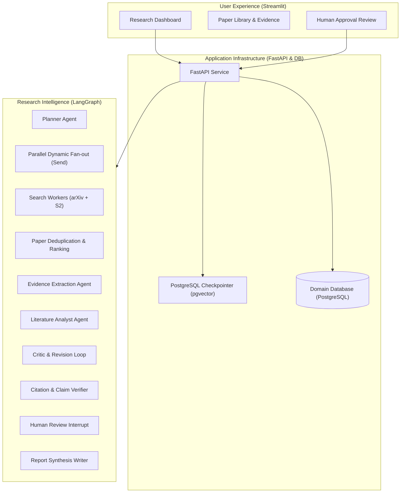

# System Architecture: Autonomous AI Research & Literature Review

## Overview
The system is an autonomous multi-agent research platform designed to ingest complex academic inquiries, retrieve grounded literature across multiple scientific repositories, extract verifiable evidence, and synthesize high-grade literature reviews with end-to-end citation provenance.

## Architectural Layers

## Core Principles
1. **Source Grounding**: Claims are strictly linked to extracted passages and bibliographic sources.
2. **Scope Awareness**: The system explicitly tracks whether evidence is drawn from full text or abstract-only metadata.
3. **Deterministic Deduplication**: Cross-provider records are unified using normalized DOIs, provider IDs, and fuzzy title matching.
4. **Resumable Execution**: Workflows persist state checkpoints to PostgreSQL, enabling pause, resume, and human oversight.

